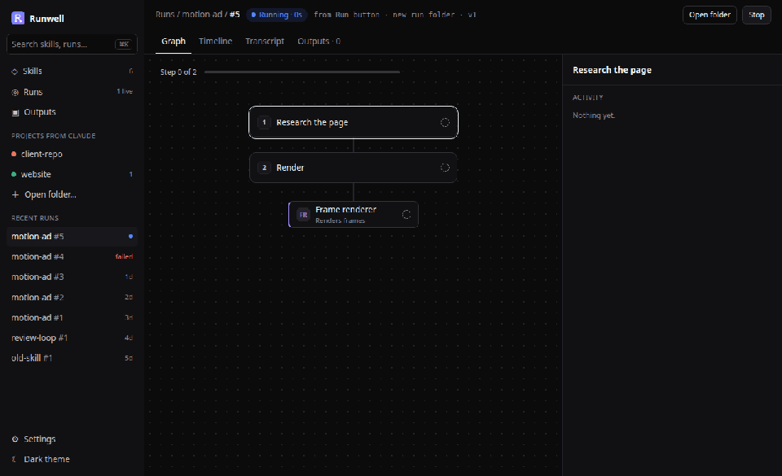
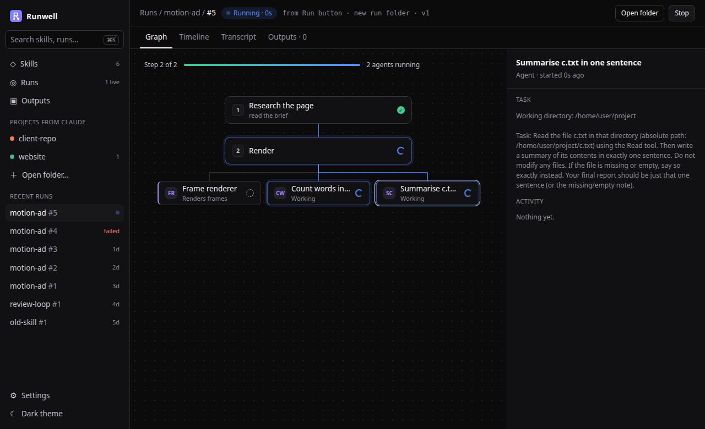
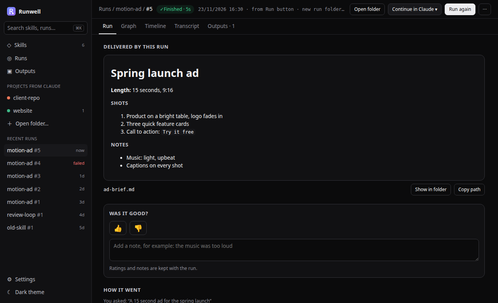

<p align="center">
  <picture>
    <source media="(prefers-color-scheme: dark)" srcset="docs/assets/brand/runwell-lockup-dark.svg">
    
  </picture>
</p>

Run your skills from a button, watch them work, keep every run. Works with Claude Code.



## Install

In Claude Code:

```
/plugin marketplace add StarlightSearch/runwell
/plugin install runwell@runwell
/runwell
```

Or without the plugin, from a terminal:

```
npx runwell
```

Needs Node 20 or newer and Claude Code. macOS and Linux.

## What you get

**Every skill on your machine, with a Run button.** Personal skills, plugin skills and the skills in your projects, each with its recent runs and how they were rated.


**A live graph of the run.** Each step of the skill down the page, the agents it starts side by side under the step that started them, and what each one is doing. Questions and permission requests from Claude show up as cards you answer in the page.



**Every run kept.** The files it made (videos, images, PDFs, HTML and markdown preview in the page), the full transcript, a timeline, a replay of the graph, and a thumbs up or down with a note. Runwell also finds the skills you used in past Claude Code chats and lists those runs too.



## Commands

| Command | What it does |
| --- | --- |
| `/runwell` | Opens Runwell in your browser |
| `/runwell run <skill> [brief]` | Starts a run of that skill and opens it |
| `/runwell last` | Opens the newest run for the folder you are in |
| `npx runwell` | The same as `/runwell`, from a terminal (`npx runwell run <skill> [brief]` and `npx runwell last` work too) |

In the page: `⌘K` or `Ctrl K` searches skills and runs, `R` runs the selected skill, `G` then `S`, `R` or `O` goes to Skills, Runs or Outputs, and `?` lists the keys.

## How a run works

- Runwell runs your own `claude` command with your own login. It never asks for an API key and never reads or stores your credentials.
- Your own permission settings apply. When Claude wants to do something your settings would ask about, the question comes to the run's page.
- By default a run works in a new folder of its own, so it does not touch your projects. Edits are allowed inside that folder. You can pick one of your projects instead, and the run works there the way a chat in that folder would.
- **Allow everything for this run** is off every time. Turned on, nothing asks first for that one run, and commands can reach outside the run's folder. Runs that had it on are labelled.
- Stop ends a run at once. A run never keeps going after Runwell stops.

## What it reads and what it never touches

**Reads:** your skill folders; `~/.claude.json`, only for project paths and whether you have trusted them; and the session logs under `~/.claude/projects`, to find the skills you used in past chats.

**Writes:** only `~/.runwell`, and a project folder only when you choose to run in it.

**Never:** your credentials, tokens or the keychain, git, your skill files, or the network. The server listens on 127.0.0.1 only and every request needs a token. There is no telemetry.

## Check the plugin yourself

```
claude plugin validate ./plugin
```

The part that runs inside Claude Code is one short file, [`plugin/hooks/register.js`](plugin/hooks/register.js) (built from [`src/plugin/mod.ts`](src/plugin/mod.ts)). At the start of a session it starts the Runwell server in the background if it is not running, and it adds `/runwell`. It makes no network calls.

## Limits in 0.1

- Runs started from the Run button (or `/runwell run`) are shown live. Skills used in a chat are read from the session logs afterwards, not live.
- Tested on Linux. macOS is checked by hand before each release. Windows is not tested.
- Built-in skills that have no files on disk are not listed.

## Next

0.2 adds live tracking of skills used in a chat, improving a skill from the runs you choose, and exporting a run as one HTML file.

## License

MIT

Made by Starlight
